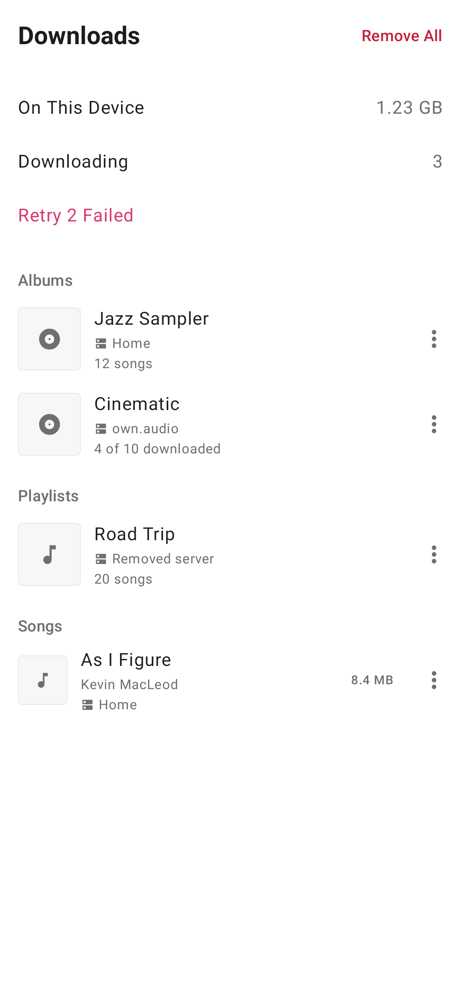

# Downloads and offline
{: .no_toc }

1. TOC
{:toc}

## Downloading

- An album or a playlist: the arrow at the top right of its page. While it downloads, the
  button shows how many songs are done; once finished it turns into a check. Tap the check for
  **Remove Download**.
- A single song: **Download** in its menu.

Downloads go on in the background, two songs at a time, with a notification while they run. If
the app is closed, they pick up where they stopped. By default they wait for Wi-Fi (**Download on
Wi-Fi Only** in Settings). Downloads are always the original file.

Downloads are kept in the app's own storage and are not included in Android's backup: they can
always be downloaded again. Uninstalling the app deletes them.

## The Downloads tab

{: width="300"}

**Downloads** lists what is on the phone:

- **On This Device**: how much space the downloads take;
- **Downloading**: how many songs are still waiting;
- **Retry … Failed**, if some failed;
- **Albums**, **Playlists** and loose **Songs**, each with the server it came from.

A downloaded album or playlist opens even with no network. Swipe a row, or use its menu, to
**Remove Download**. **Remove All** at the top removes every download; they stay on the server.

**Keep at Most** in Settings limits how much space downloads may take (1 GB to 50 GB, or **No
Limit**, the default). Over the limit, the songs not played for longest go first, never the one
playing.

## Offline mode

With no network, the app shows and plays only what is on the phone, by itself. A line above the
mini player says **No network · downloaded music only**.

You can choose the same with a network: the Wi-Fi button at the top of **Home**, or **Offline
Mode** in Settings. The line then says **Offline mode · downloaded music only**, with **Turn
Off**. It saves mobile data.

Offline:

- **Home** shows **Downloaded Albums**, and **Shuffle All** shuffles what is downloaded.
- **Library**, **Search** and **Playlists** show what is downloaded.
- Playing a list skips songs that aren't downloaded.
- Favorites, ratings, songs added to playlists and plays are kept and sent once the server can
  be reached.

### Whole library offline

With **Whole Library When Offline** on in Settings, the offline screens list everything on the
server, not just the downloads, from the copy of its catalog the app keeps on the phone (see
**Library on This Device** on the [server's page](servers.md)). What isn't downloaded is grayed
out.

## Mobile data

**On Mobile Data** in Settings decides what happens away from Wi-Fi:

- **Original**: streams the original files.
- **Saver** (the default): asks the server for a smaller MP3 of each song as it plays, at
  **Saver Quality** (320, 192 or 128 kbps; 192 by default). A server that can't make one sends
  the original.
- **Downloaded Only**: plays just what is on the phone while on mobile data. The line above the
  mini player says **Mobile data · downloaded music only**, and **Stream** switches to Saver.

With Android's Data Saver on, streams are kept at 128 kbps. Wi-Fi and downloads always get the
original file.
