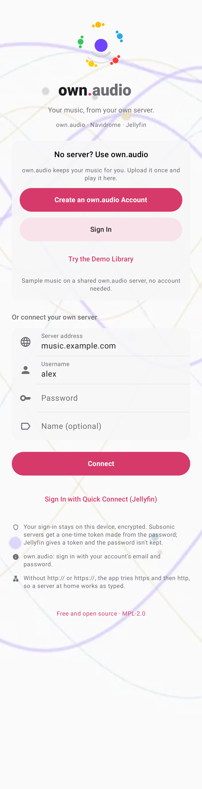

# Getting started
{: .no_toc }

1. TOC
{:toc}

## The first screen

{: width="300"}

The first screen offers two ways in: an account on own.audio's hosted service, or a server of
your own.

### No server? Use own.audio

The card at the top is for someone without a server. own.audio keeps your music for you.

- **Create an own.audio Account**: in the Google Play build, **Continue with Google** is at the
  top and makes the account on first use. Or fill in **Your Name**, **Email** and a **Password**
  of at least 12 characters (a few words are fine), then **Create Account**. The app signs in
  straight away, and own.audio emails you a link to confirm the address.
- **Sign In**: the same for an account you already have, with Google or your **Email** and
  **Password**.
- **Try the Demo Library**: signs in to a shared own.audio server with sample music, no account
  needed. It is called **own.audio demo** in the app. Remove it in Settings when you add your
  own.

### Or connect your own server

For a server you run yourself, fill in:

- **Server address**: for example `music.example.com`, or an address on your home network such
  as `192.168.1.10:4533`. Without `http://` or `https://`, the app tries https first and then
  http, so a server at home works as you type it.
- **Username** and **Password**. For own.audio, use your account's email and password.
  Jellyfin allows accounts with no password, so the password can be empty.
- **Name (optional)**: what the server is called in the app.

Then tap **Connect**. The app finds out by itself whether the server is own.audio, Subsonic or
Jellyfin, and checks the sign-in before it saves anything.

Your sign-in stays on the phone, encrypted. A Subsonic server gets a one-time token made from
the password with each request; Jellyfin and own.audio give the app a token, and the password is
not kept.

### Sign in with Google

In the Google Play build, when the address you typed is an own.audio server that takes Google
sign-in, **Continue with Google** appears under the form: "Or sign in with the Google account you
use on this own.audio server." The F-Droid build doesn't have it; use your email and password
there.

### Two-factor sign-in

If your own.audio account has two-factor sign-in on, the app asks for a second step after the
password: **Two-Factor Sign-In**. Enter the code your authenticator app shows, or one of your
recovery codes.

### Quick Connect (Jellyfin)

**Sign In with Quick Connect (Jellyfin)** signs in without typing a password here. Type the
server address, tap the button, and the app shows a code. Enter it in a Jellyfin app where you
are already signed in, under Quick Connect in your user settings. The app waits ("Waiting for
approval…") and signs in once you approve. If Quick Connect is turned off on the server, the
app says so; an administrator can turn it on in the Jellyfin dashboard.

## The tabs

Once a server is added, the app has five tabs along the bottom:

- **Home**: **Shuffle All**, what you played recently, what was added, and your playlists.
- **Library**: artists, albums, songs, genres, favorites, and concerts where the server has
  them.
- **Playlists**: see [Playlists](playlists.md).
- **Downloads**: what is on the phone. See [Downloads and offline](downloads.md).
- **Search**.

While something plays, the mini player sits above the tabs. Settings is the gear at the top
right of **Home**. Back on another tab's first page goes to **Home**.

## Several servers

You can add as many servers as you like: in Settings, under **Servers**, tap **Add a Server**.
The form is the same as on the first screen.

The library shows one server at a time, the *selected* one. To switch:

- on **Home**, tap the server menu at the top (it appears once you have more than one server)
  and pick another;
- or open the server in Settings and tap **Use This Server**.

Switching starts every tab afresh with the other server's library. What is already in the
queue keeps playing, whichever server it came from.

To remove a server, swipe it in Settings, or touch and hold it and choose **Remove**. Its
downloads leave the phone; nothing changes on the server. See
[Servers and family](servers.md) for the server's own page.
