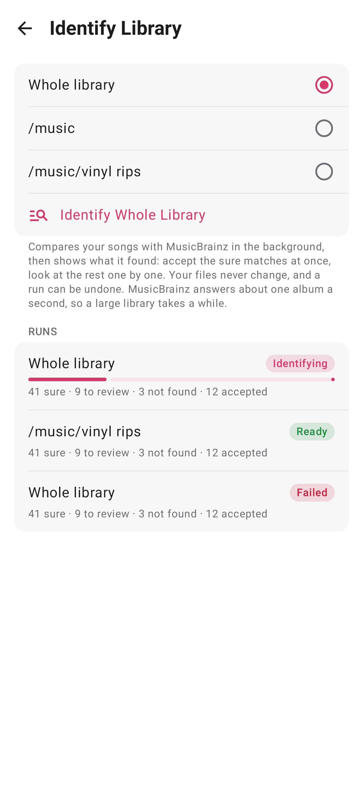

# Identify (own.audio)
{: .no_toc }

1. TOC
{:toc}

Identify lets MusicBrainz name your songs and albums on an own.audio server: titles, artists,
albums and covers. Nothing changes until you accept it, and the files stay as they are. It is
there only on own.audio servers that offer it, and only for your own songs. Where the server
charges for it, the app shows the price first and asks you to **Start**.

## Identify Library

{: width="300"}

**Identify Library** is under the grid on the **Library** tab, and on the server's page. Choose
the **Whole library** or one folder, then **Identify Whole Library** or **Identify This Folder**.

The run works on the server in the background. **Runs** lists each one with its state:
**Queued**, **Identifying**, **Waiting** (MusicBrainz is busy; the run carries on by itself),
**Ready** or **Failed**, and how many songs are sure, to review, not found and accepted. The list
updates by itself while you watch.

## Reviewing a run

A run has four tabs: **To Review**, **Sure**, **Not Found** and **Done**, grouped by album.

- **Accept … Sure Matches** takes all the sure matches at once.
- An album's menu: **Accept All … Songs**, pick **Other Edition…**, or correct the **Album** and
  **Artist** and **Search MusicBrainz** again.
- A song: **Accept** or **Reject**, **Other Recording…**, or put it back as it was.
- Notes explain why a match needs a look, such as **Weak match**, **Other album**, **Other
  artist**, **Not on this edition** or **Two files, one track**.
- **Undo Run** puts every song the run identified back the way it was. **Delete Run** deletes
  the run and its proposals; what you accepted stays.

## Other Recording

**Other Recording…** opens a search filled in from the song's tags. Correct the words if the
tags are wrong, tap **Search MusicBrainz**, and pick one of the recordings. Or paste a
recording's link or ID from musicbrainz.org under **Or Paste a Link**. Then **Use This
Recording**.

The covers of the candidate releases are loaded from the Cover Art Archive
(coverartarchive.org).

## One song, album or artist

- A song: **Identify…** or **Undo Identify…** in its menu, or under **Identify** in the player.
- An album: **Identify Album** in its **More** menu.
- An artist: **Identify Artist** in its **More** menu.

If the family doesn't have enough credit for a run, the app says so.
