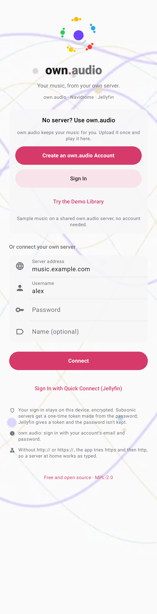
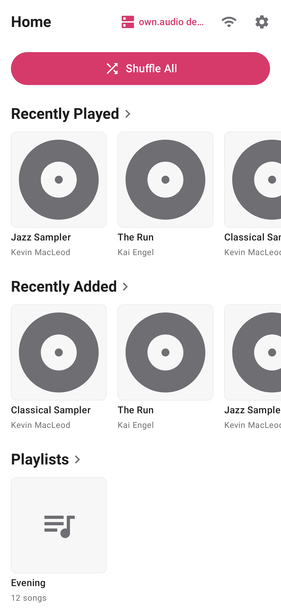
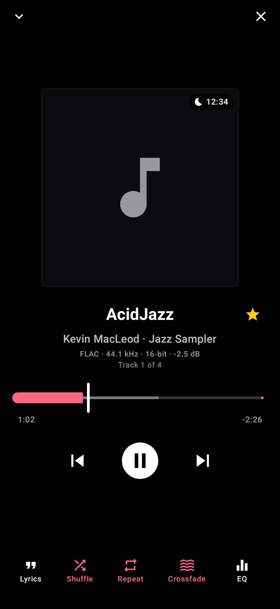
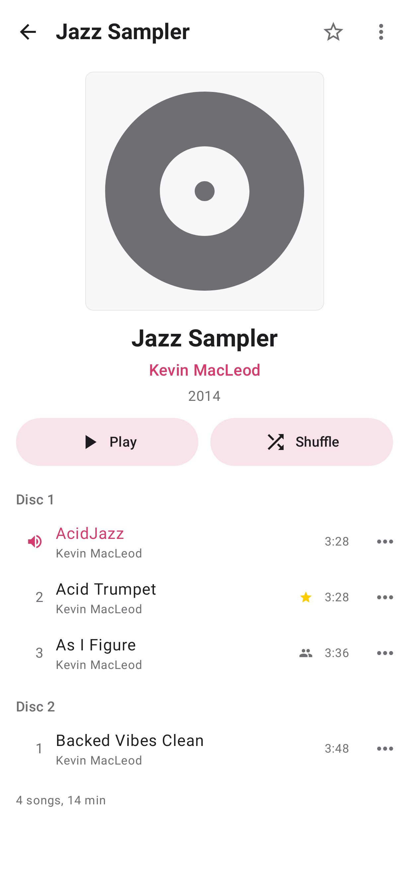

# own.audio Music for Android

own.audio Music is a music player for Android phones that plays from your own server. It works
with:

- **own.audio** servers, the hosted service or one you run yourself (version 1.0.4 or later);
- **Navidrome** and other Subsonic and OpenSubsonic servers;
- **Jellyfin**.

You can add several servers and switch between them. The app is free, has no in-app purchases,
and needs no account with us. It runs on Android 9 and later. On the home screen it is called
**own.music**.

{: width="200"}
{: width="200"}
{: width="200"}
{: width="200"}

## Getting the app

The app is not yet on Google Play. There will be two builds:

- the **Google Play** build;
- an **F-Droid** build, coming soon. It has no Google code in it, so it has no **Continue with
  Google** sign-in. Everything else is the same.

- [Privacy policy](https://github.com/own-audio/music-android/blob/main/PRIVACY.md)
- [Report a problem or ask a question](https://github.com/own-audio/music-android/issues)

## What each server can do

The app asks each server what it can do and hides what it can't, so you never see a button
that does nothing.

| Feature | own.audio | Subsonic / Navidrome | Jellyfin |
|---|---|---|---|
| Browse, search, play, queue | Yes | Yes | Yes |
| Playlists: create, rename, add, remove, delete | Yes | Yes | Yes |
| Reordering a playlist | Yes | No | No |
| Favorite songs, albums and artists | Yes | Yes | Yes |
| Star ratings and **Top Rated** | Yes | Yes | No |
| Lyrics | Yes | Where the server has them | Yes |
| Smaller streams on mobile data (**Saver**) | Yes | Where the server can make them | Yes |
| Downloads and offline mode | Yes | Yes | Yes |
| Reporting plays | Yes | Yes | Yes |
| **Instant Mix** | No | No | Yes |
| Choosing one of several music libraries | No | No | Yes |
| **Quick Connect** sign-in | No | No | Yes |
| Sign in with Apple or Google, two-factor codes | Where the server offers it | No | No |
| Smart playlists | Yes | No | No |
| Family sharing, your own covers | Yes | No | No |
| Concerts (a whole show in one file) | Where the server keeps them | No | No |
| Identify the library with MusicBrainz | Where the server offers it | No | No |
| Devices, listening statistics, deleting your account | Yes | No | No |

## In this guide

- [Getting started](getting-started.md): the first screen, the demo, an own.audio account, your own server
- [Library and search](library.md): Home, artists, albums, songs, genres, favorites, concerts, search
- [The player](player.md): controls, lyrics, queue, crossfade, equalizer, sleep timer, output
- [Playlists and smart playlists](playlists.md)
- [Downloads and offline](downloads.md)
- [Identify (own.audio)](identify.md)
- [Servers and family](servers.md): the server's page, addresses, family, devices, listening
- [Settings](settings.md)
- [Android Auto, the widget and the notification](system.md)
- [Privacy](privacy.md)
- [Troubleshooting](troubleshooting.md)

The app is open source under the MPL-2.0:
[github.com/own-audio/music-android](https://github.com/own-audio/music-android).
