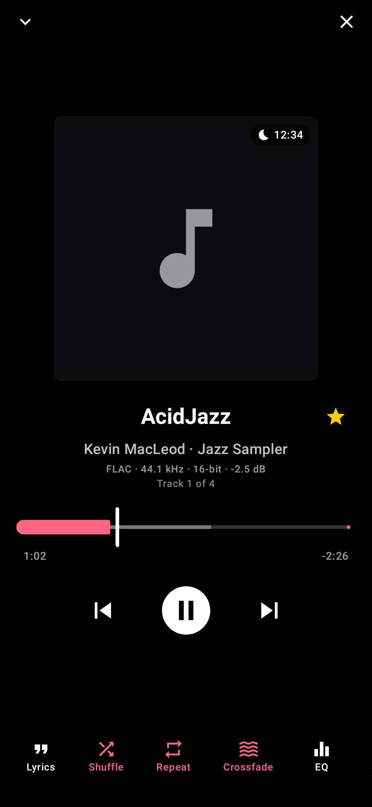

# The player
{: .no_toc }

1. TOC
{:toc}

## The mini player

While something is playing, a bar sits above the tabs with the cover, title and artist,
**Play**/**Pause** and **Next**. A thin line shows how far the song has got. Tap the bar to open
the full player.

When you open the app again later, the bar shows the song you were listening to, paused. Tap
play to go on from where you left off.

## The full player

{: width="300"}

The player is always dark. From top to bottom:

- The down arrow at the top left closes the player; the music goes on. The **✕** at the top
  right stops playback.
- The cover. Swipe it left for the next song, right for the previous one. A running sleep timer
  shows its time on the cover.
- The title, and the star to make the song a favorite.
- The artist and album.
- The format, for example **FLAC · 44.1 kHz · 16-bit**, with the volume leveling change added,
  such as **-2.5 dB**.
- **Track 1 of 4**: where the song is in the queue. In a concert, **Song 2 of 14** instead (see
  [Concerts](library.md#concerts-ownaudio)).
- The position bar. Drag it to move in the song. The part already downloaded is drawn lighter.
- **Previous**, **Play**/**Pause**, **Next**.

Songs play gapless: one runs into the next with no silence, so live and classical albums flow
as recorded. If a song can't be played, the reason is shown under the controls.

### The tools row

Under the controls is a row of tools. If it doesn't fit, scroll it sideways. A tool that is on is
drawn in the accent color.

| Tool | What it does |
|---|---|
| **Lyrics** | Opens the song's lyrics. |
| **Shuffle** | Shuffles the queue, or puts it back in order. |
| **Repeat** | Off, then repeat all, then repeat one song. |
| **Crossfade** | Crossfade on or off, its length, and volume leveling. |
| **EQ** | Opens the equalizer. |
| **Sleep** | Opens the sleep timer. |
| **Queue** | Opens the queue. |
| **Identify** | own.audio with Identify, on your own songs. See [Identify](identify.md). |
| **Output** | Opens Android's output switcher: the phone, Bluetooth headphones or another device. |

## Lyrics

**Lyrics** shows the words of the song playing. Synced lyrics follow the music: the current line
is bright and kept in the middle, and a tap on a line jumps to it. Plain lyrics just scroll. When
the server has more than one version, pick it under **Version**. With none, the app says "The
server has no lyrics for this song."

## The queue

**Queue** lists **Now Playing**, **Up Next** and **Played**. In **Up Next**, tap a song to jump to
it, drag a song by its handle to move it, and swipe it away to remove it. **Played** shows what
played before; tap one to go back to it.

To add to the queue from anywhere, use **Play Next** or **Add to Queue** in a song's or an
album's menu. Starting an album, a playlist or a list of songs replaces the queue.

## Crossfade and volume leveling

**Crossfade** makes songs fade into each other near the end. With it on, **Fade** sets the
length, from 1 to 12 seconds. It is off by default.

**Volume Leveling** uses the ReplayGain values in your files, or the loudness Jellyfin measured,
so a quiet song and a loud one play at a similar volume: **Same for Every Song** (the default),
**Same for Every Album**, which keeps an album's own quiet and loud moments, or **Off**.

## Equalizer

A six-band equalizer: **Preamp** and six bands, each from −12 to +12 dB. Turn it on with the
switch at the top. It applies to everything played. **Presets**: **Flat**, **Bass Boost**,
**Treble Boost**, **Spoken Word**, **Loudness**, **High Speed 1** and **High Speed 2**. Once you
move a slider yourself, it says **Custom**. **Reset** puts everything back to flat.

## Sleep timer

**Sleep** stops playback after 5, 15, 30, 45 or 60 minutes, or at the **End of Track**. While it
runs, it shows the **Time remaining**, **+10 minutes** and **Turn Off Sleep Timer**.
