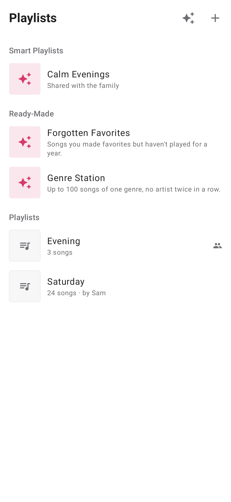

# Playlists and smart playlists
{: .no_toc }

1. TOC
{:toc}

## The Playlists tab

{: width="300"}

On own.audio, the tab starts with **Smart Playlists** you saved and **Ready-Made** ones from the
server, then your **Playlists**. Other servers show just the playlists. Each playlist shows its
number of songs, and "by …" when it belongs to someone else.

At the top: **New Smart Playlist** (own.audio) and **New Playlist**, which asks for a name.

You can also make a playlist from any song's menu: **Add to Playlist…** → **New Playlist…**.

## A playlist

A playlist shows its cover, name and description, **Play** and **Shuffle**, the songs, and the
download arrow. On a playlist of yours:

- swipe a song to remove it;
- on own.audio, drag a song by its handle to move it;
- the menu (three dots): **Rename**, **Choose Cover…** (own.audio), **Share with the
  Family** or **Stop Sharing** (own.audio with a family), and **Delete Playlist**. Deleting asks
  first: it deletes the playlist on the server, for every app that uses it.

## Ready-made playlists (own.audio)

- **Forgotten Favorites**: songs you made favorites but haven't played for a year.
- **New in the Library**: added in the last 30 days.
- **Back in Rotation**: rated four stars or more, not heard for two months.
- **What the Family Plays**: what others in the family play and you haven't yet.
- **Genre Station**: up to 100 songs of one genre, no artist twice in a row. You pick the genre
  first.

**Save as Smart Playlist** in the menu keeps one among your smart playlists, to change it.

## Smart playlists (own.audio)

A smart playlist is a rule, not a list: the songs are chosen anew each time, from your own
listening. The page says how many songs it chose and from how many that fit. **New Selection**
chooses again. In the menu:

- **Edit Rule** (yours);
- **Save as Playlist**: keeps today's selection as an ordinary playlist that won't change;
- **Delete Smart Playlist** (yours). Playlists made from it stay.

If nothing fits, the page says **Nothing Fits Right Now**; a wider rule gives more to choose from.

### The rule

**New Smart Playlist** and **Edit Rule** open the rule editor. The number of songs that fit is
updated as you change it.

- **Name**, and **Share with the Family**. Shared, each member gets their own selection, from what
  they have listened to.
- **Genres**: all, or the ones you pick.
- **Favorites Only**, **Rating at Least**.
- **Not Played For** (a month to a year), **Added in the Last** (week, month, year).
- **Played by Others, Not by Me**.
- **Tempo and Energy**: **Limit the Tempo** in BPM, and **Energy** (**Calm**, **Moderate**,
  **Energetic**). Only songs the server has analysed have these; with them set, the others are
  left out.
- **Length**: a number of songs or of minutes.
- **Order**: **Mixed, Favorites More Often**, **Best First**, **Longest Unplayed First** or
  **Random**.
- **Energy Over Time**: **Even**, **Warm Up, Steady, Cool Down**, **Building Up** or **Winding
  Down**.
- At most a number of songs per artist, and **Never the Same Artist Twice in a Row**.
