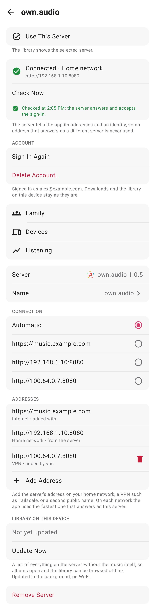

# Servers and family
{: .no_toc }

1. TOC
{:toc}

## The server's page

Open **Settings** and tap a server.

{: width="300"}

From top to bottom:

- **Use This Server**: shows this server's library.
- **Status**: whether the app is connected and how, **Connected · Home network**, **Connected ·
  VPN** or **Connected · Internet**, with the address in use. **Check Now** asks the server
  again and says what it found: it answers and accepts the sign-in, it refuses the sign-in, or
  no address answers.
- **Account**: **Sign In Again** asks for the password again (or Google, if that is how you
  signed up), for example after you changed the password. Your downloads and the library on the
  phone stay as they are. On own.audio, **Delete Account…** deletes your account on that server
  for good, with everything you added to it: music, audiobooks, podcasts, playlists and your
  listening history. What others in your family added stays with them. The app asks for your
  password first.
- **Family**, **Devices** and **Listening** (own.audio). See below.
- **Server**: the kind of server, and on own.audio its version. For Subsonic and Jellyfin, **Talks Through**
  says which API the app uses. Tap **Name** to rename the server.
- **Music Library…** (Jellyfin): a Jellyfin server can hold several music libraries. Pick one,
  or **All Music Libraries**.
- **Identify Library** (own.audio, where the server offers it). See [Identify](identify.md).
- **Connection** and **Addresses**: see below.
- **Library on This Device**: the app keeps a list of everything on the server, without the
  music itself, so albums open and the library can be browsed offline. It shows the number of
  songs and albums and when it was last updated. It is updated in the background on Wi-Fi;
  **Update Now** does it at once.
- **Remove Server**.

## Addresses

A server can have more than one address: one on your home network, one through a VPN such as
Tailscale, and a public one. Under **Addresses**, each address shows where it reaches the
server (**Home network**, **VPN** or **Internet**) and where it came from (**added with** the
server, **from the server**, or **added by you**).

- **Add Address** adds another one, for example `http://192.168.1.20:4533`.
- An address you added has a bin button to remove it.

Under **Connection**, **Automatic** lets the app pick: on each network it uses the fastest
address that answers as this server, and remembers which one worked where. You can also pick
one address to always use.

own.audio and Jellyfin servers tell the app their addresses and an identity, so an address that
answers as a different server is never used. Subsonic servers don't say which addresses they
have, so add them yourself.

## Family (own.audio)

On own.audio, a library belongs to a family: several people on one server, each with their own
account. **Family** has:

- the family's picture, name and number of members;
- **Members**: everyone in the family, with **Admin** next to the family's admin and
  **Invited** for someone who hasn't joined yet;
- **Storage**: how much the family keeps, split into **Music**, **Audiobooks** and **Podcasts**;
- **Credit**, where the server is paid for: the **Balance**, **A Month at Today's Storage** and
  how long the credit **Lasts About**. Storage is paid from the family's prepaid credit, day by
  day. Topping it up is not done in the app.

### Inviting someone

The family's admin sees **Invitations**. **Invite Someone** makes an invitation: a code for one
person, shown with a QR code and **Share Invitation**. They sign in to the same server and enter
the code, or open its link. Tap an invitation to show it again; **Withdraw** in its menu cancels
it.

### Joining another family

**Join Another Family…** asks for the code from that family's admin. Joining means leaving this
family: what the other family's members share appears instead of what this one shares.

## Sharing

What you add to the library is yours. Nothing is shared until you share it, and "not shared"
only means the others don't see it; nothing is locked.

- A song: **Share with the Family** or **Stop Sharing** in its menu.
- An album: **Share My Songs with the Family** or **Stop Sharing My Songs** in its **More**
  menu, for your own songs on it.
- A playlist of yours: **Share with the Family** or **Stop Sharing** in its menu.
- A smart playlist: **Share with the Family** in its rule. Each member then gets their own
  selection.

Songs shared with the family have a small people icon in song lists.

## Covers and pictures

On own.audio you can give your own songs, albums and playlists, and artists, a picture from your
photos: **Choose Cover…**, **Choose Album Cover…** or **Choose Picture…** in their menus. The app
uses Android's photo picker, which doesn't need access to all your photos, and sends the
picture to the server at most 1600 pixels on its longest side.

## Devices

**Devices** lists every device signed in to your account, with **This device** marked, and when
each was last used. Open a device's menu to **Sign Out** of it. **Sign Out Everywhere** ends every
session, this device's too, and asks for a fresh sign-in.

## Listening

**Listening** shows how much you listened, from every own.audio app signed in to the account,
for a **Week**, **Month**, **Year** or **All**:

- **Listened** and **Days in a Row** (and **Audiobooks Finished**, if any);
- minutes listened per day as a chart;
- **By Kind**: **Music**, **Audiobooks**, **Podcasts**;
- **Most Played**.

**Share with the Family's Admin** lets the admin see how long you listen, and to what kind.
Off, your listening stays yours. The admin sees the time of those who share it, and **Not
Shared** for the others.
